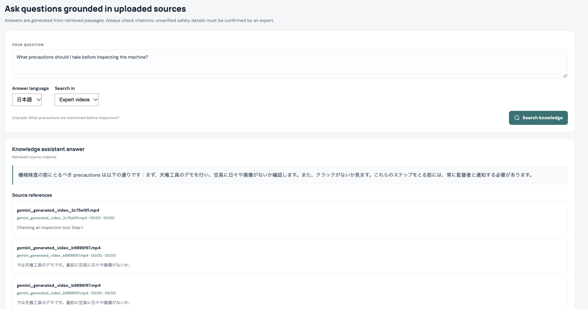
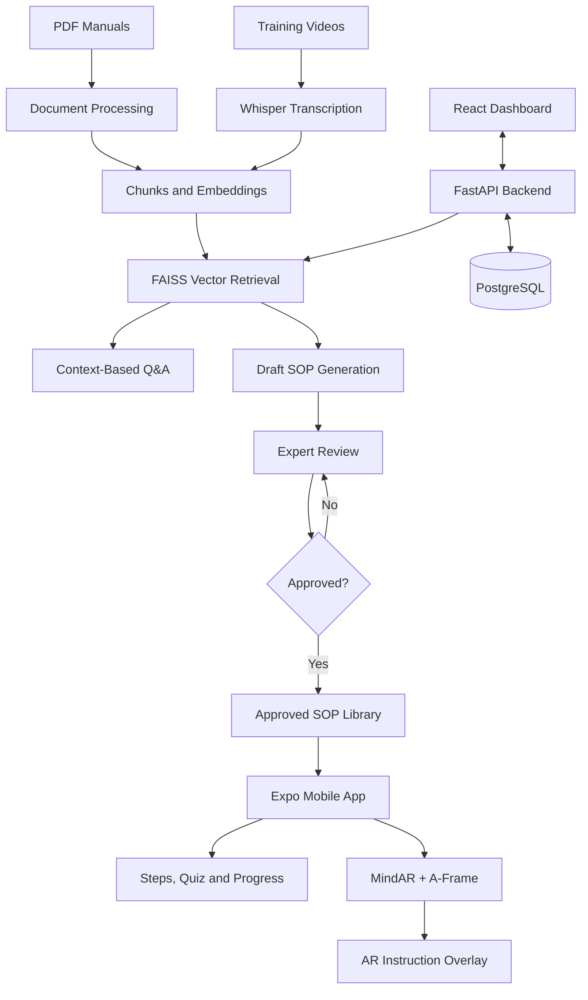
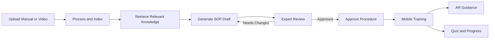

# SkillBridge AR
### AI-Powered Knowledge Preservation and Augmented Reality Training

SkillBridge AR is an AI-powered knowledge-transfer platform designed to preserve technical expertise and make it accessible to future generations of workers.

It transforms technical manuals and training videos into searchable knowledge, generates draft Standard Operating Procedures (SOPs), supports expert review, and delivers approved procedures through a mobile training application with image-based Augmented Reality (AR).

## Key Features

- **Document RAG:** Upload PDF manuals, retrieve relevant information, and ask questions with source references.
- **Video RAG:** Transcribe training videos, search timestamped transcript segments, and retrieve relevant instructions.
- **AI-Assisted SOP Generation:** Convert source material into structured procedure drafts containing steps, tools, and warnings.
- **Expert Review:** Edit, approve, or reject generated procedures before they become available for training.
- **Mobile Training:** Access approved SOPs, navigate instructions, complete quizzes, and record training progress.
- **AR Guidance:** Recognize a configured image target and display the selected procedure's current instruction and safety warning.
- **Multilingual Support:** English and Japanese options for supported question-answering and SOP-drafting workflows.

## Application Screenshots

### 1. Dashboard Overview


### 2. Document Knowledge Retrieval


### 3. Video Knowledge Retrieval



### 4. SOP Generation and Expert Review


### 5. Approved Training Library


### 6. Mobile Training Application


### 7. Augmented Reality Guidance


### 8. Training Progress


## System Architecture



### Main Components

| Component | Implementation |
|---|---|
| Web dashboard | React, JavaScript |
| Backend API | Python, FastAPI |
| Database | PostgreSQL |
| Document and video retrieval | Embeddings, FAISS |
| Local language model | Ollama, Qwen2.5:3b |
| Speech transcription | Whisper-based transcription |
| Mobile application | React Native, Expo |
| Augmented reality | MindAR, A-Frame |

## End-to-End Workflow



1. **Capture:** Upload a technical PDF or training video.
2. **Process:** Extract document text or transcribe video speech, then create searchable embeddings.
3. **Retrieve:** Find relevant source passages or timestamped transcript segments for user questions.
4. **Generate:** Use retrieved context to draft a structured SOP.
5. **Review:** A human reviewer verifies and edits the procedure before approval.
6. **Train:** Workers access approved procedures through the mobile app.
7. **Guide and track:** AR displays contextual instructions, while the app records training progress.

## Technical Implementation

### Document RAG
PDF text is extracted, divided into chunks, embedded, and indexed in FAISS. User questions retrieve relevant chunks that provide context for the language model's answer.

### Video RAG
Whisper-based transcription extracts spoken content with timestamps. Transcript segments are indexed for semantic retrieval and can be used for question answering and SOP drafting.

### SOP Review
Generated procedures are stored as drafts. Reviewers can edit procedure details, tools, warnings, and steps before approving or rejecting them. Only approved procedures are exposed through the training library.

### Mobile and AR Integration
The Expo mobile app retrieves approved procedures from the backend. AR opens a browser-based MindAR experience that recognizes a compiled image target and displays the selected procedure's title, current instruction, and warning.

**Current limitation:** AR image tracking anchors instructional overlays to a recognized image; it does not independently verify whether a worker has physically completed an action. AI-generated procedures must be checked against the original source before operational use.

## Project Structure

```text
SkillBridge-AR/
├── backend/              # FastAPI, RAG and application logic
├── web/                  # React dashboard
├── mobile/               # Expo training application
├── ar/                   # MindAR/A-Frame webpage and target files
├── docs/
│   └── screenshots/      # README screenshots
├── docker-compose.yml
├── .gitignore
└── README.md
```

## Setup and Execution

### Prerequisites
Python, Node.js/npm, Docker, Ollama, and Expo Go or a compatible Expo development environment.

### 1. Start PostgreSQL

From the project root:

```bash
docker compose up -d db
```

### 2. Start the backend

```bash
cd backend
python3 -m venv .venv
source .venv/bin/activate
pip install -r requirements.txt
uvicorn main:app --reload --host 0.0.0.0 --port 8000
```

Use the configured startup command if your backend entry point differs. API documentation: `http://localhost:8000/docs`

### 3. Start the web dashboard

In a separate terminal:

```bash
cd web
npm install
npm run dev
```

### 4. Start the AR webpage

From the project root, in a separate terminal:

```bash
python3 -m http.server 8080
```

The AR page is available at `http://localhost:8080/ar/`, assuming the page is located in the `ar/` folder.

For physical-phone camera access, expose the AR server through HTTPS using your configured tunnel:

```bash
cloudflared tunnel --url http://localhost:8080
```

Set the current tunnel URL in the web and mobile environment configurations.

### 5. Start the mobile app

```bash
cd mobile
npm install
npx expo start --lan -c
```

Configure the mobile backend URL using your computer's LAN IP address, not `localhost`.

Keep environment variables in local `.env` files and do not commit secrets. Follow the project's `.env.example` files for the exact configuration names.

## API Endpoints

| Method | Endpoint | Purpose |
|---|---|---|
| `POST` | `/api/documents/upload` | Upload and process a PDF |
| `POST` | `/api/videos/upload` | Upload and transcribe a video |
| `POST` | `/api/ask` | Ask questions about indexed knowledge |
| `GET` | `/api/sources` | Retrieve source records |
| `POST` | `/api/procedures/draft/{source_id}` | Generate a draft SOP |
| `GET` | `/api/procedures?status=draft` | Retrieve draft procedures |
| `PUT` | `/api/procedures/{id}` | Update a procedure |
| `POST` | `/api/procedures/{id}/review` | Approve or reject a procedure |
| `GET` | `/api/training/procedures` | Retrieve approved training procedures |
| `POST` | `/api/training/progress` | Save training progress |
| `GET` | `/api/training/progress` | Retrieve training progress |

See `http://localhost:8000/docs` for request formats and response schemas.

