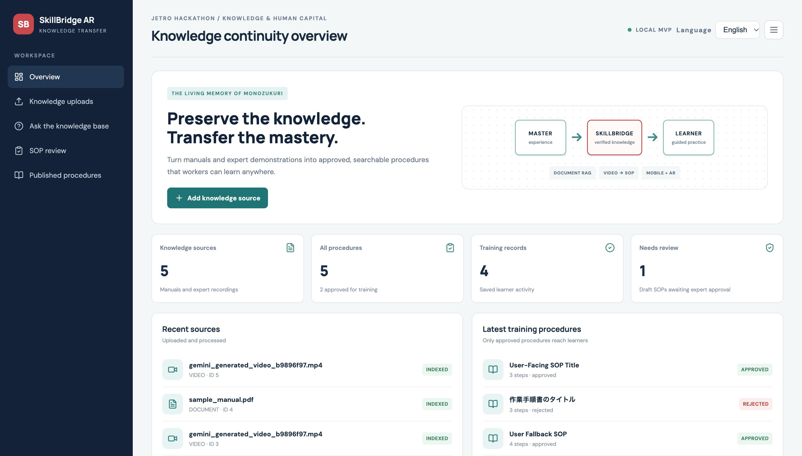
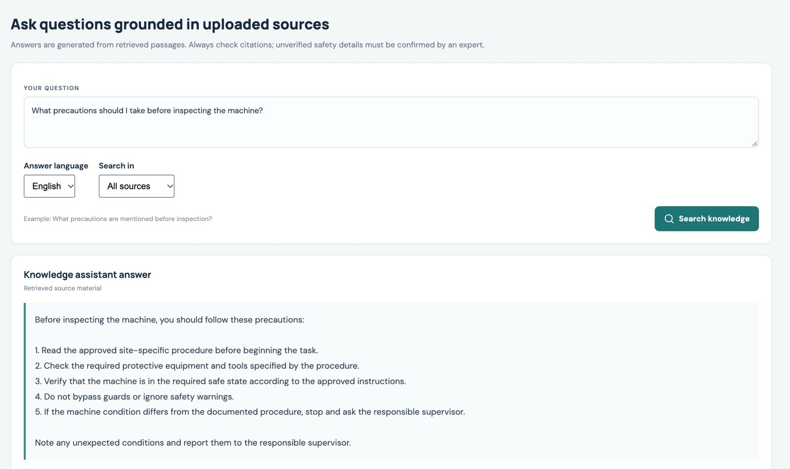
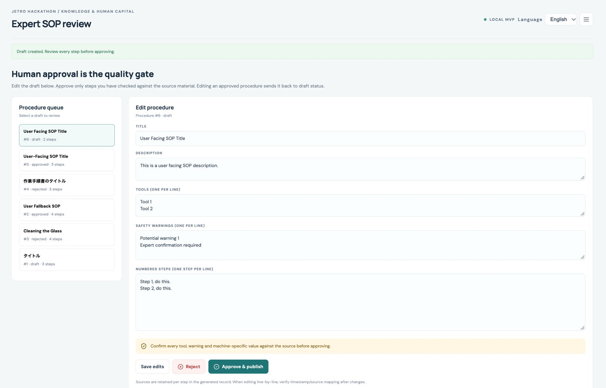
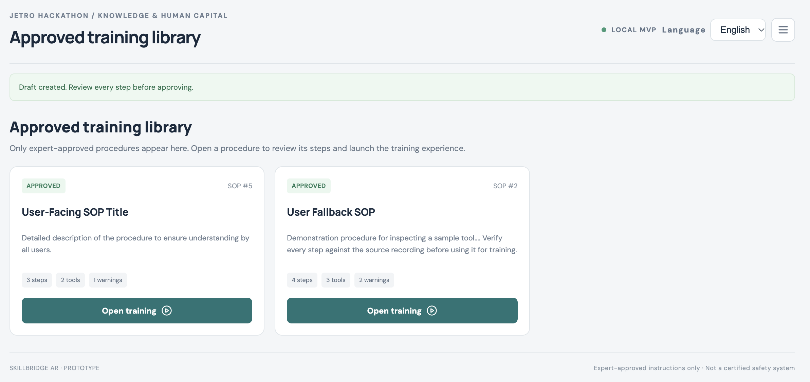
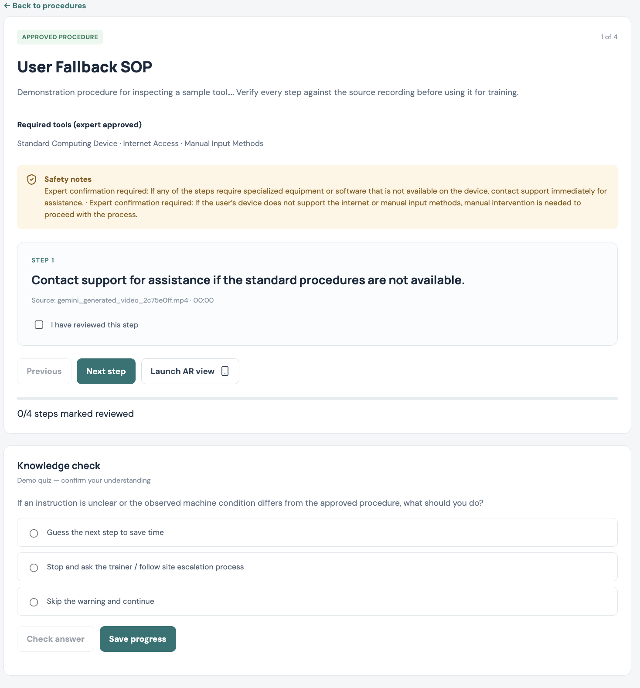
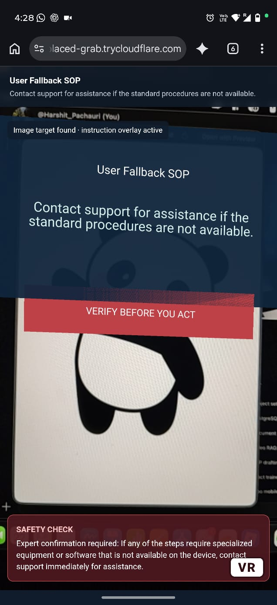
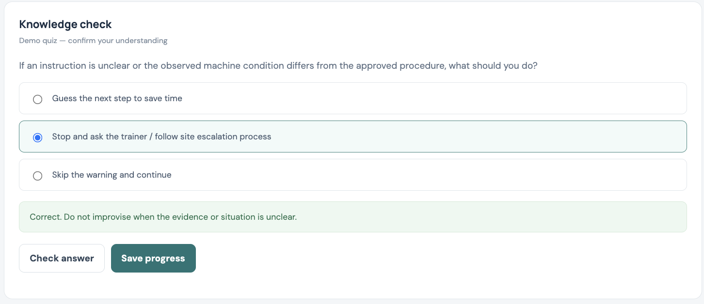
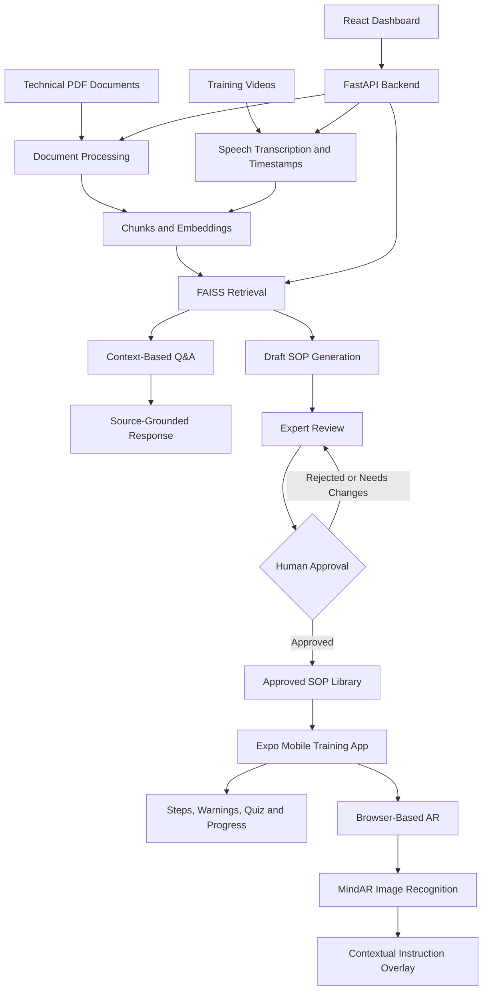
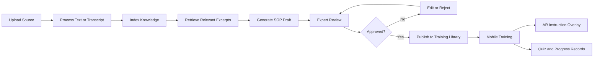

# SkillBridge AR

### Preserving Technical Expertise Through AI-Powered Knowledge Transfer and Augmented Reality

**SkillBridge AR** is an AI-powered knowledge preservation and workforce training platform designed to help organizations capture, organize, review, and transfer practical technical knowledge from experienced workers to the next generation.

Industrial organizations often depend on experienced technicians who understand how to operate equipment, perform inspections, diagnose problems, and handle unusual situations. A significant portion of this knowledge may exist in manuals, training videos, and the experience of individual workers rather than in structured, reusable procedures.

SkillBridge AR brings these knowledge sources into a single workflow. It uses Retrieval-Augmented Generation (RAG) to retrieve relevant information from documents and videos, generates draft Standard Operating Procedures (SOPs), supports expert review and approval, and delivers approved instructions through a mobile training application with image-based augmented reality (AR) overlays.

The goal is to transform scattered technical knowledge into structured, reviewed, and reusable learning material.

---

## Table of Contents

- [The Problem](#the-problem)
- [Our Solution](#our-solution)
- [Key Features](#key-features)
- [Application Screenshots](#application-screenshots)
- [System Architecture](#system-architecture)
- [How the System Works](#how-the-system-works)
- [Technology Stack](#technology-stack)
- [Project Structure](#project-structure)
- [Getting Started](#getting-started)
- [Environment Configuration](#environment-configuration)
- [API Endpoints](#api-endpoints)
- [Knowledge-to-Training Workflow](#knowledge-to-training-workflow)
- [Multilingual Support](#multilingual-support)
- [Augmented Reality Implementation](#augmented-reality-implementation)
- [Safety, Human Review, and Limitations](#safety-human-review-and-limitations)
- [Testing the Complete Workflow](#testing-the-complete-workflow)
- [Future Improvements](#future-improvements)
- [Team](#team)

---

## The Problem

### Why technical knowledge gets lost

Many organizations rely on experienced technicians to perform specialized tasks, maintain equipment, identify defects, and resolve operational problems.

However, transferring this knowledge to new employees presents several challenges:

1. **Unstructured knowledge:** Technical information is distributed across PDF manuals, videos, and individual experiences.
2. **Knowledge loss:** When experienced workers retire or leave, undocumented practical knowledge may be lost.
3. **Time-consuming training:** New employees often need repeated guidance from senior workers to understand procedures.
4. **Difficult information retrieval:** Workers may struggle to locate the right instruction within lengthy manuals or videos while performing a task.
5. **Inconsistent procedures:** Different workers may explain or perform the same task differently.
6. **Limited contextual guidance:** Traditional documents do not always make it easy to access the relevant instruction at the point where it is needed.

### Our objective

Build a practical knowledge-transfer system that converts existing technical resources into reviewed, structured procedures and makes those procedures accessible through digital and augmented-reality-assisted training.

---

## Our Solution

SkillBridge AR establishes a knowledge-transfer pipeline:

**Capture → Retrieve → Generate → Review → Approve → Train → Track**

The platform consists of five main functional components.

| Component                   | Purpose                                                                         |
| --------------------------- | ------------------------------------------------------------------------------- |
| Document RAG                | Retrieves relevant technical information from uploaded documents                |
| Video RAG                   | Transcribes training videos and retrieves relevant timestamped segments         |
| Expert Review System        | Allows generated SOPs to be reviewed, edited, approved, or rejected             |
| Mobile Training Application | Presents approved procedures, steps, warnings, quizzes, and completion tracking |
| Image-Based AR              | Displays contextual training instructions over a recognized image target        |

The components work together to transform existing technical knowledge into a structured training experience.

The system is designed around a human-in-the-loop approach: AI assists with information retrieval and procedure drafting, while a human reviewer remains responsible for approving procedures before they become available in the training library.

---

## Key Features

### 1. Document Question Answering — Document RAG

The document knowledge module allows users to upload technical PDF documents and ask questions about their contents.

The system extracts text, divides it into smaller chunks, generates embeddings, and stores searchable representations using FAISS. When a question is submitted, relevant chunks are retrieved and supplied to the language model as context for generating an answer.

Key capabilities:

- PDF document ingestion.
- Text extraction and chunking.
- Semantic search using embeddings.
- FAISS-based vector retrieval.
- Context-based question answering.
- Source references to help users inspect the supporting material.

This helps workers locate relevant information without manually searching an entire document.

### 2. Video Knowledge Retrieval — Video RAG

Technical demonstrations often contain practical knowledge that is not adequately captured in written manuals.

The video module processes uploaded videos using Whisper-based speech recognition. The resulting transcript is associated with timestamps, allowing the system to retrieve relevant portions of a video in response to a question.

Key capabilities:

- Video upload.
- Speech transcription.
- Timestamped transcript segments.
- Semantic retrieval of relevant video content.
- Question answering grounded in retrieved segments.
- Source and timestamp information to help locate the original material.
- Draft SOP generation from available source material.

For example, a training video might contain a technician checking a tool, inspecting it for cracks, comparing it with a reference card, and recording the results. A worker can search for these instructions without watching the entire video again.

The current implementation focuses on transcript-based retrieval rather than comprehensive visual understanding of video frames.

### 3. AI-Assisted SOP Generation

The platform can use retrieved source material to generate a structured draft Standard Operating Procedure.

A draft may contain:

- Procedure title and description.
- Ordered instructions.
- Required tools.
- Safety warnings.
- Available source references.
- Relevant video timestamps, where available.

The generated procedure provides a structured starting point for an expert reviewer. It is not treated as automatically authoritative simply because an AI model generated it.

### 4. Human-in-the-Loop Expert Review

A central principle of SkillBridge AR is that AI-generated procedures should be reviewed before being used for training.

The review interface supports:

- Viewing generated SOP drafts.
- Editing procedure titles and descriptions.
- Editing tools and warnings.
- Reviewing and updating procedure steps.
- Saving changes.
- Approving or rejecting a procedure.

Only approved procedures are exposed through the training library.

This approval workflow helps maintain human oversight over potentially safety-relevant technical instructions. It does not, by itself, guarantee that a procedure is technically correct or safe; the reviewer must verify it against the original source and applicable workplace requirements.

### 5. Mobile Training Application

The mobile application provides workers with access to approved procedures in a mobile-friendly interface.

Key capabilities:

- Fetching approved procedures from the backend.
- Viewing procedure details.
- Navigating through ordered instructions.
- Viewing available tools and safety warnings.
- Launching AR guidance.
- Completing training questions or quizzes.
- Recording training progress.

The objective is to make instructions easier to access at the point of learning and reduce the need to repeatedly search documents or request the same explanation from a senior technician.

### 6. Image-Based Augmented Reality

SkillBridge AR integrates browser-based AR using MindAR and A-Frame.

The AR experience uses an image target. When the camera recognizes the matching image, the interface displays contextual information such as the procedure title, current instruction, and relevant safety warning.

Key capabilities:

- Camera-based image-target recognition.
- Browser-based AR experience.
- Instruction overlays anchored to a recognized target.
- Integration with the selected training procedure.
- Contextual display of the current step and safety message.

The prototype uses image-based tracking and 2D information overlays rather than a reconstructed 3D model of industrial equipment.

The target image can be a suitable photograph, printed reference card, or other distinctive image that has been compiled into a MindAR target file.

### 7. Multilingual Support

The application includes English and Japanese language options for supported knowledge-query and SOP-drafting workflows.

The backend uses a multilingual embedding model to improve retrieval across supported languages, with language-specific instructions supplied to the language model for generated responses.

The quality of multilingual output depends on the original source material, transcription accuracy, retrieval quality, and language-model performance. Technical Japanese output should be reviewed by a knowledgeable person before it is approved for operational use.

---

## Application Screenshots

> Add your actual application screenshots to `docs/screenshots/`. The images below are placeholders for the screenshots you should capture from the running system.

### 1. Dashboard Overview




*Figure 1 — Main dashboard showing the application's navigation and available knowledge-management features.*

### 2. Document Knowledge Retrieval




*Figure 2 — Document question answering, showing a question, the generated answer, and available source references.*

### 4. SOP Drafting and Expert Review



*Figure 4 — Reviewing a generated procedure, including editable steps, tools, warnings, and review controls.*

### 5. Approved Training Library




*Figure 5 — The training library containing procedures that have passed the approval workflow.*

### 6. Mobile Training Application




*Figure 6 — Mobile training interface displaying the selected approved procedure and its instructions.*

### 7. Augmented Reality Guidance




*Figure 7 — Mobile AR experience displaying the current instruction and safety information after recognizing the target image.*

### 8. Quiz and Training Progress




*Figure 8 — Training completion, quiz, or saved progress interface.*

**Screenshot tips**

- Use screenshots captured from the actual running application; do not substitute mockups for implemented features.
- Capture the whole relevant interface while keeping text readable.
- Use consistent cropping and avoid unnecessary desktop clutter.
- Remove passwords, tokens, private data, and sensitive company information.
- Make sure every image filename matches the path used in this README.
- If a component is not available in your current build, remove its screenshot section rather than presenting it as a completed feature.

---

## System Architecture

The platform uses a modular architecture with a React dashboard, FastAPI backend, PostgreSQL database, retrieval components, language models, a React Native mobile client, and a browser-based AR experience.



### Architecture Explanation

**Frontend layer — React**

The web dashboard provides the interface for uploading knowledge sources, querying information, drafting and reviewing procedures, and managing the knowledge-transfer workflow.

**Backend layer — FastAPI**

The backend exposes REST API endpoints and coordinates document processing, video transcription, retrieval, language-model calls, procedure management, and training-progress operations.

**Knowledge retrieval layer — Embeddings and FAISS**

Documents and timestamped transcript segments are represented as searchable chunks. Embeddings support semantic retrieval, while FAISS provides vector similarity search.

**Language-model layer — Ollama and Qwen2.5:3b**

The configured local language model is used for supported answer-generation and SOP-drafting operations. Retrieved source excerpts provide context for the model's response.

**Persistence layer — PostgreSQL**

PostgreSQL stores the structured application records used by the workflow, such as source metadata, procedure records, review states, and training progress. Exact storage responsibilities depend on the implemented database schema.

**Mobile layer — React Native and Expo**

The mobile client retrieves approved procedures, provides step-by-step training, and communicates with the backend to record progress.

**AR layer — MindAR and A-Frame**

A browser-based AR page recognizes a compiled image target and presents instructions associated with the current training procedure.

---

## How the System Works

### Step 1: Upload knowledge

An administrator or authorized user uploads a technical PDF or a training video through the web interface.

The backend registers the source and processes it using the appropriate ingestion pipeline.

### Step 2: Process and index the source

For a PDF, the system extracts text and divides it into chunks.

For a video, the system transcribes speech, preserves timestamps, and prepares transcript segments for retrieval.

The resulting chunks are embedded and indexed for semantic search.

### Step 3: Retrieve relevant information

When a question is submitted, the backend searches the indexed material and retrieves relevant context.

Instead of relying exclusively on the language model's internal knowledge, the system supplies the retrieved source excerpts to help ground the answer.

Source references allow users to investigate the underlying information. Retrieval and source citations improve traceability, but they do not guarantee that every generated statement is correct.

### Step 4: Generate a draft SOP

The system can use the source material and its retrieved excerpts to draft a structured procedure.

The result is stored as a draft and is not automatically published to workers.

### Step 5: Review and approve

A human reviewer inspects the generated procedure, verifies its technical details, edits it where necessary, and approves or rejects it.

An approved SOP becomes available to the mobile training library.

### Step 6: Deliver mobile training

A worker opens the mobile application and selects an approved procedure.

The worker reads the instructions, follows the ordered steps, reviews warnings, and completes the configured quiz or training process.

### Step 7: Provide AR guidance

When the worker launches AR, the application opens the browser-based AR experience.

The camera searches for the configured image target. Once recognized, the AR interface displays the instruction content associated with the selected procedure.

### Step 8: Record progress

The training application submits progress to the backend. The system can use the saved progress records to track completion within the implemented workflow.

The current prototype records application-level training progress. It does not independently establish that every physical action was correctly performed.

---

## Technology Stack

| Layer              | Technology                  | Purpose                                            |
| ------------------ | --------------------------- | -------------------------------------------------- |
| Web frontend       | React, JavaScript           | Dashboard and knowledge-management interface       |
| Mobile frontend    | React Native, Expo          | Mobile training and procedure navigation           |
| Backend            | Python, FastAPI             | REST API and application logic                     |
| Database           | PostgreSQL                  | Structured application records                     |
| Document retrieval | Embeddings, FAISS           | Semantic search over technical content             |
| Language model     | Ollama, Qwen2.5:3b          | Local language-model inference for supported tasks |
| Speech recognition | Whisper-based transcription | Extracting timestamped speech from videos          |
| AR framework       | MindAR, A-Frame             | Image tracking and instruction overlays            |
| Local development  | VS Code, Docker             | Development environment and database services      |

### Why this technology stack?

- **FastAPI** provides a lightweight way to create Python APIs for AI processing and application workflows.
- **FAISS and embeddings** support semantic search over technical content.
- **Ollama and Qwen2.5:3b** provide a local inference option without requiring a paid hosted language-model API for the configured model calls.
- **Whisper-based transcription** turns spoken training content into searchable text.
- **React Native and Expo** allow the training interface to be developed for mobile devices.
- **MindAR and A-Frame** provide a practical browser-based AR prototype without requiring a native AR application or a full 3D reconstruction pipeline.
- **PostgreSQL** provides structured persistence for the application's records.

Some model weights, dependencies, or browser resources may require internet access during initial setup. Local inference does not automatically mean that every part of the application works entirely offline.

---

## Project Structure

The following is a representative structure for the application's major components. Keep the actual filenames and folders aligned with the project repository.

```text
SkillBridge-AR/
│
├── backend/
│   ├── main.py
│   ├── config.py
│   ├── schemas.py
│   ├── knowledge.py
│   ├── reindex_embeddings.py
│   ├── requirements.txt
│   └── .env.example
│
├── web/
│   ├── src/
│   │   └── App.jsx
│   ├── public/
│   ├── package.json
│   └── .env.example
│
├── mobile/
│   ├── App.js
│   ├── package.json
│   └── .env.example
│
├── ar/
│   ├── index.html
│   └── inspection-target.mind
│
├── docs/
│   └── screenshots/
│       ├── dashboard-overview.png
│       ├── document-rag.png
│       ├── video-rag.png
│       ├── sop-review.png
│       ├── approved-procedures.png
│       ├── mobile-training.png
│       ├── ar-guidance.png
│       └── training-progress.png
│
├── docker-compose.yml
├── .gitignore
└── README.md
```

This tree is illustrative, not a claim that every file or directory already exists. Retain your real project structure and include only files that are actually present.

---

## Getting Started

### Prerequisites

Before running the project, install and configure:

- Python and pip.
- Node.js and npm.
- Docker Desktop with Docker Compose.
- Ollama.
- Git.
- Expo Go or a supported Expo development environment for mobile testing.
- Cloudflare Tunnel (`cloudflared`) if you need to access the local AR webpage through HTTPS on a physical phone.

Python and JavaScript dependency versions should follow the versions and lockfiles used in the repository.

### 1. Clone the repository

```bash
git clone <YOUR_GITHUB_REPOSITORY_URL>
cd <YOUR_PROJECT_FOLDER>
```

Replace the placeholders with the actual repository URL and folder name.

### 2. Configure environment variables

Create the required local environment files from the included example templates, if those templates exist:

```bash
cp backend/.env.example backend/.env
cp web/.env.example web/.env
cp mobile/.env.example mobile/.env
```

Adjust the paths if your project keeps its configuration files elsewhere.

**Never commit real `.env` files containing credentials, passwords, tokens, or other secrets.**

### 3. Start the database

From the repository root:

```bash
docker compose up -d db
```

This command assumes your Compose file defines a service named `db`. If the service has a different name, use the name declared in your Compose configuration.

Ensure the backend's database connection settings match the actual PostgreSQL configuration.

### 4. Configure the local language model

Install Ollama using the official instructions at [ollama.com](https://ollama.com/).

Then obtain the model used by the project:

```bash
ollama pull qwen2.5:3b
```

Start Ollama if it is not already running. Confirm that the configured model is available before testing model-dependent endpoints.

### 5. Install backend dependencies

```bash
cd backend
python3 -m venv .venv
source .venv/bin/activate
pip install -r requirements.txt
```

For Windows, activate the virtual environment using the appropriate Windows activation command.

Start the backend using the application's configured entry point. For a backend whose FastAPI instance is named `app` in `main.py`, a typical command is:

```bash
uvicorn main:app --reload --host 0.0.0.0 --port 8000
```

Use the actual startup command from your project if it differs.

Once started, the API documentation should be available at:

`http://localhost:8000/docs`

### 6. Install and start the web dashboard

Open another terminal:

```bash
cd web
npm install
npm run dev
```

Open the local URL printed by Vite in the terminal.

Ensure `VITE_API_URL` points to the running backend.

### 7. Start the AR webpage locally

From the project root, open another terminal:

```bash
python3 -m http.server 8080
```

The AR page should be accessible locally at:

`http://localhost:8080/ar/`

This URL assumes the AR HTML file is in the `ar/` directory and is served from the repository root.

### 8. Configure HTTPS access for AR

Camera access on a physical mobile device generally requires a secure context, such as HTTPS, or an eligible localhost context.

To expose your local AR server through a temporary Cloudflare Quick Tunnel, run:

```bash
cloudflared tunnel --url http://localhost:8080
```

Copy the current HTTPS URL printed by the command. Configure the dashboard and mobile AR URL variables to point to that URL and the correct AR path.

Keep the tunnel running during the demo. Quick Tunnel URLs can change when the tunnel is restarted.

### 9. Configure and launch the mobile app

Open another terminal:

```bash
cd mobile
npm install
npx expo start --lan -c
```

Configure the mobile API URL to use your development computer's LAN IP address rather than `localhost` when testing on a physical phone.

For example:

```dotenv
EXPO_PUBLIC_API_URL=http://<YOUR_COMPUTER_LAN_IP>:8000
EXPO_PUBLIC_AR_URL=https://<YOUR_CURRENT_TUNNEL_HOST>/ar/
```

Use the actual URL values from your environment. Ensure your phone and computer can reach one another and that local firewall settings permit the required connections.

---

## Environment Configuration

The exact variables depend on the current `.env.example` files. The following table describes the key settings used in this setup.

| Variable                         | Component | Purpose                                                      |
| -------------------------------- | --------- | ------------------------------------------------------------ |
| `VITE_API_URL`                   | Web       | Backend API base URL                                         |
| `VITE_AR_URL`                    | Web       | URL of the browser-based AR webpage                          |
| `EXPO_PUBLIC_API_URL`            | Mobile    | Backend URL reachable from the mobile device                 |
| `EXPO_PUBLIC_AR_URL`             | Mobile    | HTTPS URL used to launch AR                                  |
| `EMBEDDING_MODEL`                | Backend   | Embedding model used to encode and retrieve knowledge chunks |
| Database configuration variables | Backend   | PostgreSQL connection settings                               |
| Ollama/model configuration       | Backend   | Local language-model endpoint and model selection            |

The configured multilingual embedding model is:

`sentence-transformers/paraphrase-multilingual-MiniLM-L12-v2`

The backend's actual environment variable names and database settings should be taken from its `.env.example` file. Do not add arbitrary settings that the application does not read.

---

## API Endpoints

The backend exposes the following application routes in the current implementation.

| Method | Endpoint                            | Purpose                                    |
| ------ | ----------------------------------- | ------------------------------------------ |
| `POST` | `/api/documents/upload`             | Upload a document source                   |
| `POST` | `/api/videos/upload`                | Upload and process a video source          |
| `POST` | `/api/ask`                          | Ask a question about indexed knowledge     |
| `GET`  | `/api/sources`                      | Retrieve available source records          |
| `POST` | `/api/procedures/draft/{source_id}` | Generate a draft procedure from a source   |
| `GET`  | `/api/procedures?status=draft`      | Retrieve draft procedures                  |
| `PUT`  | `/api/procedures/{id}`              | Update a procedure                         |
| `POST` | `/api/procedures/{id}/review`       | Submit a review decision                   |
| `GET`  | `/api/training/procedures`          | Retrieve procedures available for training |
| `POST` | `/api/training/progress`            | Submit training progress                   |
| `GET`  | `/api/training/progress`            | Retrieve training progress                 |

For request payloads, query parameters, and response schemas, use the running API documentation at `/docs`. In particular, the video-upload route may accept a language parameter, and the ask endpoint supports response-language selection in the current multilingual workflow.

---

## Knowledge-to-Training Workflow

The platform connects knowledge ingestion and worker training through a controlled lifecycle.



The approval gate is important: document or video ingestion alone does not make an instruction available for operational training. A generated procedure must pass the review workflow.

---

## Multilingual Support

The application includes English and Japanese selections for supported question-answering and procedure-drafting workflows.

The multilingual retrieval model helps represent text from supported languages in a shared semantic space. Language preferences are passed to the relevant backend operations so the language model can generate output in the requested language.

Multilingual processing introduces practical challenges:

- Spoken technical terminology can be difficult to transcribe accurately.
- Similar technical terms can have different meanings depending on their context.
- Mixed-language answers may require normalization or an additional refinement step.
- A technically fluent translation may still contain an incorrect procedure.

For these reasons, language support should be evaluated using real English and Japanese examples, with outputs reviewed by a competent speaker or subject-matter expert before approval.

---

## Augmented Reality Implementation

### Current approach

The AR prototype uses MindAR image tracking with A-Frame for browser-based rendering.

The process is:

1. A reference image is selected for the training demonstration.
2. The image is processed by the MindAR target compiler to generate a `.mind` target file.
3. The AR webpage loads that target file.
4. The mobile camera searches for the matching image.
5. Once the image is recognized, the page displays the contextual instructions associated with the training session.

The reference target can be a printed card or a suitable image displayed on another device.

### What AR currently demonstrates

The implemented experience demonstrates how image recognition can be used to display contextual training content associated with an SOP.

The AR overlay can show the selected procedure title, current step, and safety warning when those values are passed from the mobile application.

### What AR does not currently do

The current prototype does not automatically:

- Understand every physical object or piece of industrial machinery.
- Detect whether a worker has performed an action correctly.
- Detect defects such as cracks without a separately implemented and validated vision model.
- Verify safety compliance using camera footage alone.
- Reconstruct industrial equipment as a detailed 3D model.

These are potential future extensions, not capabilities implied by image tracking itself.

---

## Safety, Human Review, and Limitations

SkillBridge AR is a knowledge-transfer and training prototype. AI-generated content should not be treated as a certified replacement for approved workplace procedures, qualified supervisors, or equipment-specific safety requirements.

Important limitations include:

**Retrieval quality:** If the source document or transcript is incomplete or ambiguous, the system may retrieve insufficient evidence.

**Generation accuracy:** A language model can produce unsupported or misleading statements. Source references assist verification but do not guarantee correctness.

**Speech transcription:** Noisy recordings, specialized vocabulary, and multilingual speech can reduce transcription accuracy.

**Human approval:** A qualified reviewer must verify the technical accuracy and safety of each procedure before it is used for real operational tasks.

**AR tracking:** Image recognition provides a visual anchor for an overlay; it does not prove that a physical action has been performed.

**Progress tracking:** Application-level completion and quiz records represent recorded learning activity. They are not independent proof of real-world competence.

**Network and local dependencies:** The backend, database, model service, and AR webpage must be accessible for their respective features to work. Physical-device testing may require LAN connectivity and an HTTPS tunnel.

---

## Testing the Complete Workflow

A successful end-to-end test should cover the following sequence:

- [ ] Start PostgreSQL, the backend, the dashboard, the AR webpage, and the mobile app.
- [ ] Upload a known sample PDF.
- [ ] Ask a question that can be answered from the PDF and inspect the source reference.
- [ ] Upload a sample training video and verify the transcript or timestamps.
- [ ] Generate a draft SOP from an available source.
- [ ] Verify the instructions, warnings, and tools against the source.
- [ ] Edit and approve the procedure.
- [ ] Confirm that the approved procedure appears in the training library.
- [ ] Open the procedure in the mobile application.
- [ ] Launch AR and scan the matching target image.
- [ ] Verify that the displayed title, instruction, and warning match the selected training step.
- [ ] Complete the available quiz or progress workflow.
- [ ] Confirm that progress is saved and can be retrieved.

Use a known, reviewed sample procedure during demonstrations. If the AR target or tunnel fails, keep screenshots of previously verified interfaces as backup presentation material.

---

## Future Improvements

Potential extensions include:

1. **More robust technical video understanding:** Add visual analysis of frames and better alignment between visual actions and transcribed speech.
2. **Object-specific AR targets:** Support a managed library of targets linked to particular equipment and procedures.
3. **Visual verification:** Investigate validated computer-vision models for narrowly defined inspection tasks.
4. **Expert feedback and versioning:** Track revisions, reviewers, approval timestamps, and changes to procedures.
5. **Role-based access control:** Differentiate administrators, experts, and trainees with appropriate permissions.
6. **Improved training analytics:** Provide aggregated completion and quiz results for authorized supervisors.
7. **Offline support:** Package approved training material and essential assets for controlled offline use.
8. **More comprehensive Japanese evaluation:** Test transcription, retrieval, and generation with real technical vocabulary and expert-reviewed examples.
9. **Integration with equipment documentation systems:** Explore controlled imports from existing maintenance and training repositories.

These are potential development directions; they should not be interpreted as already implemented functionality.

---

## Team

**SkillBridge AR** was developed as a knowledge-preservation and workforce-training prototype.

- **Harshit Madhav Pachauri**
- **Diya Narang**
- **Siddarth Chandra**

---

## Conclusion

SkillBridge AR demonstrates a practical approach to preserving technical expertise and making it reusable across generations of workers.

By combining document and video retrieval, AI-assisted SOP drafting, human expert review, mobile training, and image-based augmented reality, the platform connects previously scattered technical knowledge to a structured training workflow.

The core idea is simple: **capture knowledge, keep humans responsible for validation, and make approved expertise easier for the next worker to access and learn from.**

SkillBridge AR is a prototype toward that goal, with a modular architecture that can be extended as more advanced technical understanding, validation, and deployment requirements are addressed.
